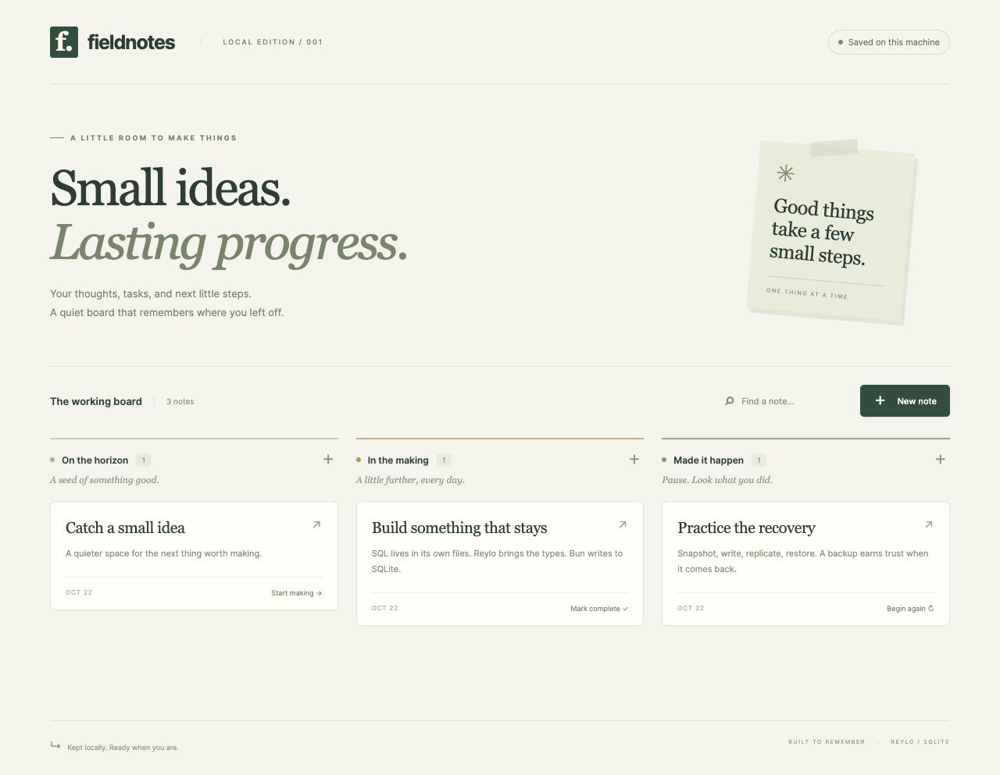

# Fieldnotes · Reylo × Bun SQL × sqlite-js-stream

A small local task board with persistent notes, three columns, search, and an edit dialog. This is an experimental integration of real libraries, with a repeatable backup and recovery drill. It uses synthetic data and local files; there is no hosted deployment or cloud account.



## Architecture

```text
Dedicated browser → 127.0.0.1:4173 → Bun HTTP app
                                     │
                         Reylo .sql imports + .run(db, params)
                                     │
                           Bun SQL SQLite adapter
                                     │
                               data/app.db + WAL
                                     │ read-only snapshot + direct file reads
                         separate Node replication process
                                     │
                        Replica + FileReplicaClient → replicas/local/ltx/
                                     │ restore
                              separate fresh SQLite DB
```

The application imports `SQL` from `bun` and constructs `new SQL({ adapter: "sqlite", filename, safeIntegers: true })`. It enables WAL, a 5-second busy timeout, and foreign keys. Every CRUD operation is an imported `.sql` query executed with Reylo `.run()` on that client. **The app does not use `bun:sqlite`.**

Reylo's TypeScript 7.1 content mapper infers parameters, projected columns, and result cardinality from the schema in `data/app.db`. `.reylo.yaml` fixes that development schema path; `DB_PATH` separately chooses the runtime file. Initialize the development schema before typechecking or building. No handwritten SQL module declarations or generated query types are used. Runtime hooks are loaded in both sections of `bunfig.toml`; the bundle uses the official `reylo/esbuild` plugin.

The Node process uses `@platformatic/sqlite-js-stream`'s `Replica` and `FileReplicaClient`. The library depends on `node:sqlite` for its independent read-only snapshot connection, while reading SQLite/WAL pages and producing real LTX files. Bun and Node share file paths, not handles. The watch command serializes `sync()` calls and fails loudly on errors, rather than using the upstream `run()` loop, which logs transient errors and continues. A process lock prevents overlapping commands for the same source DB.

## Verified versions

| Component | Exact version |
| --- | --- |
| Bun | 1.4.4 (`38afee6c8`) |
| Node | 24.22.1 |
| TypeScript | 7.1.0-beta |
| reylo / @reylosql/sqlite | 0.2.0 / 0.2.0 |
| @platformatic/sqlite-js-stream | 0.1.4 |

These runtimes were installed and their actual versions checked on Eris.local, Apple Silicon, on 2026-10-22. The requested patched releases are pinned in `mise.toml`. `bun.lock` pins the dependency tree.

## Install and run

Prerequisite: [mise](https://mise.jdx.dev/) on `PATH`. These scripts store runtime installations, caches, and mise state under the ignored `.tools/` directory. They do not select or replace any global runtime.

```sh
sh scripts/bootstrap.sh
scripts/tools bun install --frozen-lockfile
scripts/tools bun --version   # 1.4.4
scripts/tools node --version  # v24.22.1
scripts/tools bun run init    # idempotent schema + 3 synthetic notes if empty
scripts/tools bun run start
```

Open **http://127.0.0.1:4173**. Use `PORT=4175 scripts/tools bun run start` if that port is occupied. The server binds only to `127.0.0.1`. Stop it with Ctrl-C; restarting the same command reopens the same database. `scripts/tools bun run dev` enables watch mode. To initialize an empty board, run `scripts/tools bun scripts/init.ts --empty` before the first start.

Create notes with **New note**, edit with the arrow on a card, and advance notes using the action at the bottom of each card. The edit dialog also selects a column or deletes the note after confirmation. Search filters loaded notes locally. Text is rendered through `textContent`, so literal markup remains text.

## Test, typecheck, and build

Run after initialization:

```sh
scripts/tools bun test
scripts/tools bun run typecheck
scripts/tools bun run build
scripts/tools bun dist/server.js
```

The typecheck script runs **Node** with `typescript/bin/tsc --noEmit --runExternalCode`; the content mapper is real and reads the live development schema. `test/types.ts` includes valid inferred assignments and required negative checks with `@ts-expect-error` for wrong parameters, missing parameters, missing columns, and nullable lookups. The build uses `Bun.build()` with Reylo's official plugin. Run the bundle from this repository; `public/` and `db/schema.sql` remain external assets, so `dist/` alone is not a distributable package.

## Backup and continuous replication

The default source is `data/app.db`, destination is `replicas/local`, and status file is `data/replication-status.json`. No credentials are needed.

```sh
# One-shot sync + full level-9 snapshot:
scripts/tools bun run backup

# Or, in a separate terminal while the app is running:
scripts/tools bun run replicate
# Writes an initial snapshot, then syncs every second; Ctrl-C performs a final sync.

# Explicit incremental sync, with no new full snapshot:
scripts/tools node scripts/replica.ts sync
```

Watch, sync, backup, and restore are mutually exclusive for a source DB. Stop the watcher before issuing another command. A successful sync prints `healthy: true`, `inSync: true`, and equal local/remote TXIDs (serialized as strings). The watch status also has `running: true` and a `checkedAt` timestamp. Check both freshness and health; a stale file is not proof that the process is running. A failure writes `healthy: false` and exits nonzero. If a crash leaves `data/app.db.replication.lock`, confirm the recorded PID is no longer running before removing that lock manually.

For other synthetic databases, set **both** paths to a dedicated pair:

```sh
DB_PATH=data/another.db REPLICA_DIR=replicas/another scripts/tools bun run backup
```

## Restore and compare

Stop the app and watcher to compare a stable source, then take a final backup. Use a target that does not exist; the wrapper refuses the source itself, existing outputs, WAL/SHM sidecars, and temporary restore files.

```sh
scripts/tools bun run backup
scripts/tools bun run restore --output data/recovered-001.db
scripts/tools node scripts/check-db.ts data/app.db data/recovered-001.db
# {"equal":true,"rows":3,"schemaEqual":true,"integrity":"ok",...}

# Inspect the restored copy through the actual application on a different port:
DB_PATH=data/recovered-001.db PORT=4175 scripts/tools bun run start
```

The equality check compares every task field, application schema/index definitions, and `user_version`, and runs `PRAGMA integrity_check` on both files. It compares logical content, not SQLite's physical file bytes. The restored copy becomes an independent writable app DB if started this way; do not point its replication at the original replica directory.

## Repeat the recovery experiment

```sh
scripts/tools bun run drill
```

This creates a unique ignored directory under `artifacts/drill-*`, starts a Bun server on an ephemeral loopback port, and drives real HTTP CRUD. It verifies process-restart persistence; snapshot → committed update/delete/insert → incremental sync → fresh restore; rollback exclusion; checkpoint/truncate and a new WAL generation across restart; live periodic replication; equality and integrity of three fresh restores; lock refusal; existing-target refusal; and an invalid destination producing an unhealthy status and nonzero exit. All drill processes stop afterward. Its databases, replica LTX files, and detailed `results.json` stay local and ignored.

### Observed results · 2026-10-22

- **5 automated tests passed**, 29 assertions: actual Reylo/Bun SQL CRUD, persistent reopen, injection/quotes/markup round-trip, input validation, cross-origin write refusal, rollback, and static asset restrictions.
- **Typecheck and build passed** with the pinned tools and negative inference fixtures.
- Snapshot at TXID **1** plus incremental TXID **2** restored **2 equal rows**. After checkpoint/restart TXID **3** restored **3 equal rows**. The live watcher captured TXID **4**, restoring **4 equal rows**. Schema equality and `integrity_check = ok` passed for every restore.
- Continuous replication lock refusal and existing restore target refusal passed. An invalid local replica destination exited **1** with `healthy: false`.
- The compiled server passed health, HTML/assets, and real insert/delete checks.
- Dedicated in-app browser QA passed create, edit, move, search, and reload persistence with no browser errors. Desktop and **390 × 844** mobile screenshots were inspected; mobile document width equaled viewport width. See [desktop](docs/desktop.jpg), [mobile](docs/mobile.jpg), and the sanitized [validation record](docs/validation.json).

## Limits

This is a small integration experiment, not a production backup guarantee. The local file replica shares the machine and failure domain; it does not protect against disk loss, theft, or deletion of both directories. There are no cloud credentials, paid services, external deployment, accounts, authentication, or public access.

Periodic replication can lose writes since the last successful sync. An equal `syncStatus()` describes the cached LTX position at that check, not future writes. The UI's saved indicator describes the app's successful database read/write, not backup health. Watch mode takes a startup snapshot and retains LTX files without scheduled compaction or retention; disk use grows. Use a separate replica directory for each independent source DB and only one replication owner per source. A stale process lock needs manual inspection after a crash.

SQLite and the libraries remain experimental here: TypeScript is a beta and the two integration packages are early releases. The small synthetic drill does not establish large-database throughput, arbitrary crash recovery, multiple writers, cross-machine restore, power-loss durability, or Windows support. The schema initializer is idempotent setup, not a versioned migration framework. Reylo's SQLite CHECK constraints do not infer the status string union; the API and database enforce allowed values. Named parameters appear once per statement. JSON-like strings are bound as parameters, avoiding the upstream-documented Bun SQL quote issue. SQL preparation at typecheck time uses Reylo's SQLite engine, while runtime execution uses Bun's SQLite, so stay within syntax verified by both.

## Official references checked

- [Reylo source, setup and supported drivers](https://github.com/colinhacks/reylo), [Bun example](https://github.com/colinhacks/reylo/tree/main/examples/bun), [SQLite rules](https://reylo.dev/sqlite), and [query-writing agent guidance](https://github.com/colinhacks/reylo/blob/main/skills/using-reylo/SKILL.md)
- [Bun SQL SQLite adapter](https://bun.sh/docs/runtime/sql), [Bun 1.4.4 release](https://github.com/oven-sh/bun/releases/tag/bun-v1.4.4), and [requested trust-store fix PR 46300](https://github.com/oven-sh/bun/pull/46300)
- [sqlite-js-stream API and architecture](https://github.com/platformatic/sqlite-js-stream), including the installed 0.1.4 source for snapshot consistency, `Replica.sync()`, `.snapshot()`, `.syncStatus()`, `.restore()`, and `.close()`

Repository intentionally has no added license, hosted deployment, or unrelated CI configuration.
